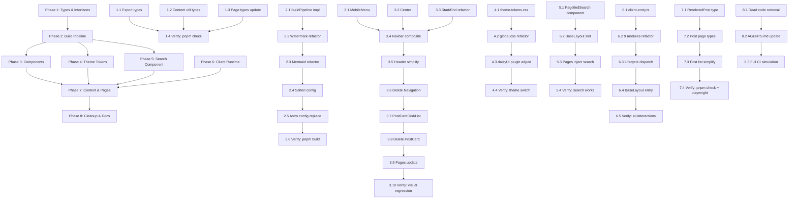

# 重构实施计划

> [!NOTE] 设施状态（2026-10）
> 项目正按 `REWRITE_PLAN.md` **从零重写**：`src/`、`.github/workflows/`、`.agents/scripts/`、`.agents/tasks/` 均已在工作区就位。
> 文中 `⏸` 标注对应**尚未落地**的部分。`tgcloud/` 目录从未存在；Bot 源码为根级 `handlers/`、`schema.js`。

## 概览

基于 `docs/adr/0001-functional-architecture.md` 的深度模块架构，将现有浅模块代码重构为 8 个 Phase。每 Phase 独立可回滚，`git tag phase-{1..8}-done` 标记。

---

## Phase 依赖拓扑



**并行度**: Max 4 (Phase 1/3/4/5/6 可并行不同组)
**关键路径**: P1.1→P1.4 → P2.1→P2.6 → P3.1→P3.10 → P7.1→P7.4 → P8.3
**预估**: 4-5 周（单人串行约 80h，并行可压缩至 40h）

---

## Phase 详细任务

### Phase 1: Types & Interfaces (Week 1)

**目标**: 建立类型系统单一源头，消除 `any`、`as unknown as`

| Task                   | Assignee            | 产出                                                                                                        | 验收                  |
| ---------------------- | ------------------- | ----------------------------------------------------------------------------------------------------------- | --------------------- |
| 1.1 Export types       | content-engineer    | `src/modules/types.ts` ⏸ 统一导出 `PostFrontmatter`、`BlogCollection`、`TelegramAuthConfig`、`RenderedPost` | `pnpm check` 0 errors |
| 1.2 Content util types | content-engineer    | `src/utils/content.ts` ⏸ 返回类型显式化，消除隐式推导                                                       | 无隐式 any            |
| 1.3 Page types update  | frontend-architect  | `src/pages/*.astro` ⏸ 导入 types 模块，移除本地类型定义                                                     | 类型统一              |
| 1.4 Verify             | quality-dx-guardian | `pnpm check && pnpm exec tsc -b` 全绿                                                                       | CI 绿灯               |

**里程碑**: `git tag phase-1-done`

---

### Phase 2: Build Pipeline (Week 2)

**目标**: 统一 5 个构建阶段，复用 FileWalker，错误聚合

| Task                     | Assignee              | 产出                                                                            | 验收       |
| ------------------------ | --------------------- | ------------------------------------------------------------------------------- | ---------- |
| 2.1 BuildPipeline impl   | build-deploy-engineer | `src/modules/build-pipeline.ts` ⏸ 接口 + 实现，`execute(distDir)` 串行跑 5 阶段 | 单入口     |
| 2.2 Watermark refactor   | build-deploy-engineer | `src/integrations/watermark.ts` ⏸ 作为 Stage 注册，仅处理原创文章               | 仅原创注入 |
| 2.3 Mermaid refactor     | build-deploy-engineer | `src/integrations/mermaid-compile-time.ts` ⏸ 作为 Stage，复用 FileWalker        | 无闪烁     |
| 2.4 Satteri config       | content-engineer      | `src/integrations/satteri-config.ts` ⏸ 整合到 build hooks                       | 无重复处理 |
| 2.5 Astro config replace | build-deploy-engineer | `astro.config.ts` 移除 4 旧集成，仅注册 `build-hooks`                           | 配置简化   |
| 2.6 Verify               | quality-dx-guardian   | `pnpm build` 全绿，`dist/client/pagefind/` 存在                                 | CI 绿灯    |

**里程碑**: `git tag phase-2-done`

---

### Phase 3: Components (Week 2-3)

**目标**: 复合组件模式，消除布尔属性爆炸

| Task                   | Assignee            | 产出                                                   | 验收       |
| ---------------------- | ------------------- | ------------------------------------------------------ | ---------- |
| 3.1 MobileMenu         | frontend-architect  | `src/components/navbar/MobileMenu.astro` ⏸             | 独立可复用 |
| 3.2 Center             | frontend-architect  | `src/components/navbar/Center.astro` ⏸                 | slots 组合 |
| 3.3 Start/End refactor | frontend-architect  | `Start.astro` ⏸/`End.astro` ⏸ 提取                     | 单职责     |
| 3.4 Navbar composite   | frontend-architect  | `Navbar.astro` ⏸ 组合 4 子组件                         | 复合模式   |
| 3.5 Header simplify    | frontend-architect  | `Header.astro` ⏸ 仅作布局容器                          | 无逻辑     |
| 3.6 Delete Navigation  | frontend-architect  | 删除 `Navigation.astro` ⏸ 旧组件                       | 无死代码   |
| 3.7 PostCardGrid/List  | frontend-architect  | `PostCardGrid.astro` ⏸/`PostCardList.astro` ⏸ 变体分离 | 两种视图   |
| 3.8 Delete PostCard    | frontend-architect  | 删除 `PostCard.astro` ⏸ 旧组件                         | 无死代码   |
| 3.9 Pages update       | frontend-architect  | `index.astro` ⏸/`posts/[id].astro` ⏸ 使用新组件        | 页面正常   |
| 3.10 Verify            | quality-dx-guardian | Visual regression + Playwright 绿灯                    | 无视觉差异 |

**里程碑**: `git tag phase-3-done`

---

### Phase 4: Theme Tokens (Week 3)

**目标**: CSS 变量单一源头，daisyUI 完全解耦

| Task                      | Assignee            | 产出                                                                 | 验收       |
| ------------------------- | ------------------- | -------------------------------------------------------------------- | ---------- |
| 4.1 theme-tokens.css      | frontend-architect  | `src/styles/theme-tokens.css` ⏸ 定义所有 `--color-*`、`--tw-prose-*` | 单一源头   |
| 4.2 global.css refactor   | frontend-architect  | `global.css` ⏸ 仅 `@import "theme-tokens.css"` + Tailwind + daisyUI  | 无重复变量 |
| 4.3 daisyUI plugin adjust | frontend-architect  | `@plugin "daisyui/theme"` 引用 CSS 变量，`prefersdark` 自动适配      | 深色自动   |
| 4.4 Verify                | quality-dx-guardian | 主题切换无闪烁，Prose 样式同步                                       | 无视觉差异 |

**里程碑**: `git tag phase-4-done`

---

### Phase 5: Search Component (Week 3)

**目标**: Pagefind 声明式 UI 组件化，CSS 变量主题适配

| Task                         | Assignee                  | 产出                                                                 | 验收       |
| ---------------------------- | ------------------------- | -------------------------------------------------------------------- | ---------- |
| 5.1 PagefindSearch component | search-discovery-engineer | `src/components/search/PagefindSearch.astro` ⏸ 声明式 `<pagefind-*>` | 零 JS 样板 |
| 5.2 BaseLayout slot          | frontend-architect        | `BaseLayout` 增加 `slot="search"` 注入                               | 插槽化     |
| 5.3 Pages inject search      | search-discovery-engineer | 文章页/列表页注入搜索组件                                            | 全站可搜   |
| 5.4 Verify                   | quality-dx-guardian       | 搜索功能正常，主题切换样式同步                                       | E2E 绿灯   |

**里程碑**: `git tag phase-5-done`

---

### Phase 6: Client Runtime (Week 4)

**目标**: 单一入口注册表，9 模块依赖管理，条件加载，TelegramAuth 分层降级

| Task                          | Assignee            | 产出                                                                                                  | 验收         |
| ----------------------------- | ------------------- | ----------------------------------------------------------------------------------------------------- | ------------ |
| 6.1 client-entry.ts           | frontend-architect  | `src/modules/client-runtime.ts` ⏸ 接口 + 实现，`registerModule`/`start()`                             | 单一入口     |
| 6.2 9 modules refactor        | frontend-architect  | `src/scripts/modules/*.ts` ⏸ 导出 `init(ctx)`，`dependsOn` 声明依赖                                   | 模块化       |
| 6.3 TelegramAuth 分层降级重构 | frontend-architect  | `src/scripts/modules/telegram-auth.ts` ⏸ 重构为：分层降级策略 + 多入口 UI + Cookie偏好记忆 + 手动切换 | 分层降级架构 |
| 6.4 Lifecycle dispatch        | frontend-architect  | `astro:page-load`/`astro:after-swap` 分发，拓扑排序初始化                                             | 顺序正确     |
| 6.5 BaseLayout entry          | frontend-architect  | `BaseLayout` 单一 `<script>` 引入并启动                                                               | 无碎片       |
| 6.6 Verify                    | quality-dx-guardian | 所有交互正常，View Transitions 切换无重复初始化                                                       | E2E 绿灯     |

**里程碑**: `git tag phase-6-done`

### Phase 7: Content & Pages (Week 4)

**目标**: 内容管道类型安全，页面零类型断言，Telegram 受保护路由

| Task                     | Assignee              | 产出                                                                       | 验收               |
| ------------------------ | --------------------- | -------------------------------------------------------------------------- | ------------------ |
| 7.1 RenderedPost type    | content-engineer      | `src/modules/types.ts` ⏸ 新增 `RenderedPost` 接口                          | 类型完整           |
| 7.2 Post page types      | content-engineer      | `src/pages/posts/[id].astro` ⏸ 使用 `contentPipeline.renderPost()`         | 零断言             |
| 7.3 Post list simplify   | content-engineer      | `src/pages/posts/index.astro` ⏸ 使用 `contentPipeline.getPublishedPosts()` | 逻辑简化           |
| 7.4 Protected route impl | build-deploy-engineer | `tgcloud/endpoints/getPostContent.js` ⏸ JWT 验证 + 群成员校验 + 返回 HTML  | 受保护内容路由可用 |
| 7.5 Verify               | quality-dx-guardian   | `pnpm check + playwright` ⏸ 全绿，RSS/站点地图有效                         | CI 绿灯            |

**里程碑**: `git tag phase-7-done`

---

### Phase 8: Cleanup & Docs (Week 5)

**目标**: 删除死代码，文档同步，CI 全绿

| Task                   | Assignee            | 产出                                                                                                       | 验收                  |
| ---------------------- | ------------------- | ---------------------------------------------------------------------------------------------------------- | --------------------- |
| 8.1 Dead code removal  | 全员                | 删除 `.astro`/`.ts` 未使用导出、旧集成、旧组件                                                             | `pnpm check` 无未使用 |
| 8.2 AGENTS.md update   | quality-dx-guardian | 同步实现状态、命令、架构指针                                                                               | 文档一致              |
| 8.3 Full CI simulation | quality-dx-guardian | `pnpm check && pnpm build && pnpm exec oxlint . && pnpm exec oxfmt --check && pnpm exec playwright test` ⏸ | 全绿                  |

**里程碑**: `git tag phase-8-done` → **Release v1.0.0**

---

## 质量门禁

每 Phase 完成前必须通过：

| 质量门禁 | 命令                                                 | 标准     |
| -------- | ---------------------------------------------------- | -------- |
| 类型检查 | `pnpm check`                                         | 0 errors |
| Lint     | `pnpm exec oxlint .`                                 | 0 errors |
| 格式     | `pnpm exec oxfmt --check`                            | 0 diffs  |
| 构建     | `pnpm build`                                         | success  |
| 角色专属 | `pnpm exec tsx .agents/scripts/run-gate.ts <role>` ⏸ | 绿灯     |

---

## 回滚策略

| 场景               | 动作                                             |
| ------------------ | ------------------------------------------------ |
| Phase 内单任务失败 | `git checkout phase-{N-1}-done` 回滚到上一 Phase |
| Phase 整体失败     | 同上，保留已完成 Phase 成果                      |
| Phase 间接口破坏   | 新建 ADR 记录破坏性变更，给 1 Phase 迁移期       |

---

## 技术债登记

| ID     | 描述                             | 优先级 | 计划 Phase | Owner               |
| ------ | -------------------------------- | ------ | ---------- | ------------------- |
| TD-001 | daisyUI 5 迁移指南文档化         | 中     | Phase 4    | frontend-architect  |
| TD-002 | ThemeTokens 增加 `--color-focus` | 低     | Phase 4    | frontend-architect  |
| TD-003 | `astro:before-swap` 预加载优化   | 低     | Phase 6    | frontend-architect  |
| TD-004 | 学习脚本自动化集成到 CI          | 中     | Phase 8    | quality-dx-guardian |
| TD-005 | 跨仓库知识同步机制               | 低     | 后续       | quality-dx-guardian |

---

## 状态追踪

```bash
# 查看当前 Phase
cat .phase-current  # 内容如: "3"

# 查看任务状态
ls .agents/tasks/phase-3/
# 标记 Phase 完成
echo "4" > .phase-current
git tag phase-3-done
```

---

## 相关文档

- `docs/adr/0001-functional-architecture.md`

- 架构设计
- `docs/adr/0004-subagent-coordination.md`

- 子智能体协作
- `docs/adr/0008-agents-knowledge-base-architecture.md`

- 知识库架构
- `docs/adr/0009-knowledge-update-process.md`

- 知识更新流程
- `.agents/tasks/PHASE_COMPLETION_TEMPLATE.md` ⏸ - Phase 完成清单
