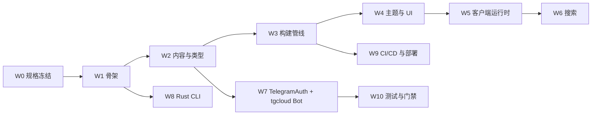

# 重写计划（Rewrite Plan）

**Last Updated:** 2026-10-12
**依据:** [`PROJECT_STATUS.md`](./PROJECT_STATUS.md)

> [!IMPORTANT] 这不是恢复
> 既有源码设施（`src/`、`.github/workflows/`、`.agents/scripts/`、`.agents/tasks/`、`handlers/` 等）曾**有意移除**，项目据此**从零重写**（W0–W10 已完成，见 §7）。
> git 历史中的旧实现**仅作行为参考与规格素材**，**不作为恢复来源**：**不执行** `git restore` / `git revert` 取回旧代码。
> 重写的"规格"由现有文档承担：`CONTEXT.md`、`docs/adr/**`、`docs/architecture-map.md`、`docs/SECURITY_WHITEPAPER.md`、`docs/*.md`。

---

## 0. 原则

| 原则         | 说明                                                                     |
| ------------ | ------------------------------------------------------------------------ |
| 文档即规格   | 先冻结接口/契约，再写实现；规格冲突以 `PROJECT_STATUS.md` + ADR 为准     |
| 不复制旧代码 | 旧实现只用于确认行为与边界；新代码重新设计，避免继承历史技术债           |
| 深度模块     | 按 ADR 0001 的 7 个 deep module 边界与接口实现                           |
| 契约先行     | 接口变更先更 `CONTEXT.md` / `.agents/contracts/` / ADR，再实现           |
| 质量内建     | 每阶段以 `pnpm check` / `pnpm build` / `oxlint` / `oxfmt` 与角色门禁收口 |
| 逐段可交付   | 每阶段独立可验收，保持主干可构建，避免大爆炸式合并                       |

---

## 1. 重写范围

| 范围        | 内容                                                                              |
| ----------- | --------------------------------------------------------------------------------- |
| Astro 博客  | `src/`：pages、layouts、components、modules、integrations、scripts、styles、posts |
| tgcloud Bot | `handlers/`、`schema.js`、`tgcloud.jsonc`                                         |
| Rust CLI    | `src/post-edit/main.rs`（`pnpm post:edit`）                                       |
| 构建/部署   | `.github/workflows/`、`pagefind.yaml`、`message-filters.txt`                      |
| 工具设施    | `.agents/scripts/`、`.agents/tasks/`                                              |
| 测试        | Playwright E2E（当前缺失，需从零配置）                                            |

---

## 2. 阶段总览

---

## 3. 阶段明细

| 阶段 | 目标                       | 主要产出                                                                        | 依赖   | 验收                                        | 规格参考                                                 |
| ---- | -------------------------- | ------------------------------------------------------------------------------- | ------ | ------------------------------------------- | -------------------------------------------------------- |
| W0   | 规格冻结 ✅                | 决策点已锁定（§5）                                                              | —      | 术语单一来源、无自相矛盾                    | `docs/**`、`PROJECT_STATUS.md`                           |
| W1   | 项目骨架                   | `astro.config.ts`、`tsconfig.json`、`package.json`、目录树                      | W0     | `pnpm install && pnpm check` 通过           | `docs/GETTING_STARTED.md`、`AGENTS.md`                   |
| W2   | 内容与类型                 | `content.config.ts`、`modules/types.ts`、`content-pipeline.ts`                  | W1     | `pnpm check` 0 error；示例文章可渲染        | `docs/CONTENT_GUIDE.md`、白皮书 §4.2                     |
| W3   | 构建管线                   | `integrations/build-hooks.ts`、`build-pipeline.ts`、`pagefind.yaml`             | W2     | `pnpm build`；`dist/client/pagefind/` 生成  | `REFACTOR_PLAN.md` Phase 2、`IMPLEMENTATION_PROGRESS.md` |
| W4   | 主题与 UI                  | `theme-tokens.css`、`global.css`、`components/**`、`BaseLayout`                 | W2     | 深浅色切换；daisyUI 语义类可用              | ADR 0005、`docs/VISUAL_DESIGN_SPEC.md`                   |
| W5   | 客户端运行时               | `modules/client-runtime.ts`、`scripts/**`、`client-entry.ts`                    | W4     | View Transitions 下模块仅初始化一次         | ADR 0007                                                 |
| W6   | 搜索                       | `modules/search.ts`、`components/PagefindSearch.astro`                          | W3、W4 | 索引生成且搜索可用                          | ADR 0006、`docs/SEARCH_TUNING.md`                        |
| W7   | TelegramAuth + tgcloud Bot | `modules/telegram-auth.ts`、`handlers/message.js`、`schema.js`、`tgcloud.jsonc` | W2     | `tgcloud run` 本地可跑；受保护路由生效      | 白皮书 §4、ADR 0012、`docs/TELEGRAM_AUTH_COMPARISON.md`  |
| W8   | Rust CLI                   | `src/post-edit/main.rs`                                                         | W1     | `cargo test && cargo clippy && cargo audit` | `docs/POST_EDIT_CLI.md`                                  |
| W9   | CI/CD 与部署               | `.github/workflows/deploy.yml`、`knowledge-guard.yml`                           | W3、W7 | workflow 语法正确；各目标可部署             | `docs/DEPLOYMENT.md`、ADR 0003                           |
| W10  | 测试与门禁                 | `playwright.config.ts`、`tests/e2e/**`                                          | W4–W7  | `pnpm exec playwright test` 通过            | `docs/TESTING.md`                                        |

---

## 4. 目标架构

按 ADR 0001 定义的 **7 个 deep module** 重写，类型由 `src/modules/types.ts` 单一导出：

| 模块              | 职责                                             |
| ----------------- | ------------------------------------------------ |
| `ContentPipeline` | Content Collections、Zod schema、渲染与类型导出  |
| `BuildPipeline`   | Pagefind → lychee → vnu → Mermaid → Watermark    |
| `ThemeSystem`     | CSS Token + daisyUI 主题 + prose 适配            |
| `SearchModule`    | Pagefind 索引与声明式 UI                         |
| `ClientRuntime`   | 客户端单一入口 + 模块注册表 + 生命周期           |
| `TelegramAuth`    | 认证墙 UI + 受保护路由 + JWT                     |
| `UIComponents`    | 复合组件库（Navbar / PostCard / PagefindSearch） |

详见 `docs/architecture-map.md` 与 `docs/adr/0001-functional-architecture.md`。

---

## 5. 决策点（已确认 · 2026-10-09）

| #   | 决策项       | 结论                                                                                      |
| --- | ------------ | ----------------------------------------------------------------------------------------- |
| 1   | 技术选型     | **全部沿用**：Astro 7、Node standalone adapter、Satteri、Tailwind 4 + daisyUI 5、Pagefind |
| 2   | 子智能体设施 | **保留** `.agents/scripts/`、`.agents/tasks/` 与 6 角色协作模型                           |
| 3   | E2E 方案     | **Playwright**（新增 `@playwright/test`），见 `docs/TESTING.md`                           |
| 4   | 文件命名     | **完全沿用**（`pagefind.yaml`、`message-filters.txt`、`src/post-edit/main.rs` 等）        |
| 5   | tgcloud 配置 | 沿用 `docs/tgcloud-sdk.md` 与 ADR 0012 设计，`tgcloud.jsonc` + `schema.js` 于 W7 落地     |

> **W0（规格冻结）已完成**：以上决策即后续阶段的约束，不再另行确认。

---

## 6. 风险

| 风险                                 | 缓解                                                       |
| ------------------------------------ | ---------------------------------------------------------- |
| 规格与旧实现行为不一致               | 用旧实现做对照验证，但以文档为最终依据                     |
| 大范围重写导致长期不可构建           | 逐阶段保持绿色；每阶段可独立合并                           |
| 文档本身存在矛盾                     | 以 `PROJECT_STATUS.md` + ADR 为准，先修正规格再实现        |
| tgcloud 平台限制（V8、无 Node 内建） | 遵循 `docs/tgcloud-sdk.md`；避免 Node-only 依赖            |
| 恢复冲动（有人误用 git restore）     | 本文件与 `PROJECT_STATUS.md` 明确禁止把 git 历史当恢复来源 |

---

## 7. 进度追踪

| 阶段 | 状态    | 备注                                         |
| ---- | ------- | -------------------------------------------- |
| W0   | ✅ 完成 | 决策点已锁定                                 |
| W1   | ✅ 完成 | 骨架（`astro.config.ts`、`tsconfig.json`）   |
| W2   | ✅ 完成 | 内容与类型（`content.config.ts` 等）         |
| W3   | ✅ 完成 | 构建管线（`integrations/build-pipeline.ts`） |
| W4   | ✅ 完成 | 主题与 UI                                    |
| W5   | ✅ 完成 | 客户端运行时                                 |
| W6   | ✅ 完成 | 搜索（Pagefind）                             |
| W7   | ✅ 完成 | TelegramAuth + tgcloud Bot                   |
| W8   | ✅ 完成 | Rust CLI（`src/post-edit/main.rs`）          |
| W9   | ✅ 完成 | CI/CD 与部署                                 |
| W10  | ✅ 完成 | Playwright E2E 与门禁                        |

- 每完成一个阶段：更新本表 + `PROJECT_STATUS.md` §5，并移除对应 `⏸` 标注。
- 架构级决策补 ADR（迁移决策已见 `docs/adr/0012-tgcloud-migration.md`）。
- 质量命令：`pnpm check && pnpm build && pnpm exec oxlint . && pnpm exec oxfmt --check`。
