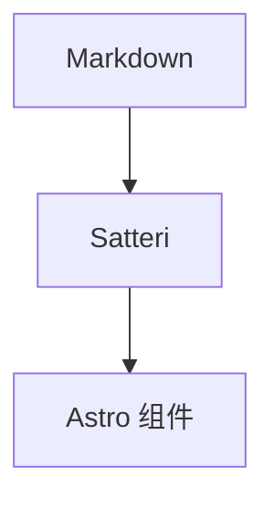

# 内容创作指南 (Content Guide)

**Status**: Draft — 待评审
**Date**: 2026-10-09
**适用范围**: `src/posts/*.md` / `*.mdx` ⏸ 的撰写、草稿管理、发布
**关系**:

- 前置元数据 schema 的**唯一权威**是 `docs/SECURITY_WHITEPAPER.md` §4.2（Zod）
- 术语定义见 `CONTEXT.md`（Post、Draft、Frontmatter、Satteri、MermaidDiagram 等）
- 排版与视觉规则见 `docs/VISUAL_DESIGN_SPEC.md`
- CLI 发布工具见 `docs/POST_EDIT_CLI.md`

> [!NOTE] 设施状态（2026-10）
> 项目正按 `REWRITE_PLAN.md` **从零重写**：`src/`、`.github/workflows/`、`.agents/scripts/`、`.agents/tasks/` 均已在工作区就位。
> 文中 `⏸` 标注对应**尚未落地**的部分。`tgcloud/` 目录从未存在；Bot 源码为根级 `handlers/`、`schema.js`。

---

## 1. 文章存放与集合

| 项       | 位置 / 说明                                                                        |
| -------- | ---------------------------------------------------------------------------------- |
| 已发布   | `src/posts/*.md` 或 `src/posts/*.mdx`                                              |
| 草稿     | `src/posts/drafts/`                                                                |
| 集合     | 全站仅一个集合 `blog`                                                              |
| 加载器   | `glob({ base: "./src/posts", pattern: "**/*.md{,x}" })` ⏸（见 ADR 0001、ADR 0002） |
| 处理链   | Markdown → Satteri（`@astrojs/markdown-satteri`）；MDX → `@astrojs/mdx`            |
| 内容来源 | Git 即内容源，无 CMS；正文与前置元数据都随仓库版本管理                             |

---

## 2. 文件命名与 slug / id 规则

| 项           | 规则                                                                         |
| ------------ | ---------------------------------------------------------------------------- |
| **id**       | 由文件路径经 glob loader 生成（去扩展名）；`drafts/` 下文件带 `drafts/` 前缀 |
| **slug**     | 取自 id，用于路由 `/posts/[id]` 与受保护路由 `/api/posts/[id]/protected`     |
| **推荐命名** | ASCII kebab-case，例：`astro-7-migration-notes.md`                           |
| **中文标题** | 文件名仍建议 ASCII；CLI（`post-edit`）用 `pinyin` 生成 slug                  |
| **禁止字符** | 空格、下划线、大写、`#`、`?`、`/`、连续 `--`；用单个 `-` 分词                |
| **日期前缀** | 可选（如 `2026-08-26-...`）；是否启用 `generateId` 日期策略 ⏸ 待确认         |

**重命名 = 改 URL**：id 绑定路径，重命名文件会改变永久链接。若无重定向机制，旧链接将失效（⏸ 待确认是否配置 `redirects`）。

---

## 3. Frontmatter 参考

字段定义来自 `docs/SECURITY_WHITEPAPER.md` §4.2 的 Zod schema。**没有 `draft` 字段**——草稿状态由路径决定（见 §4）。

| 字段           | 类型             | 必填 | 约束                               | 示例                                  |
| -------------- | ---------------- | ---- | ---------------------------------- | ------------------------------------- |
| `title`        | `string`         | ✅   | ≤200 字符（`z.coerce.string()`）   | `"Astro 7 迁移踩坑记"`                |
| `description`  | `string \| null` | ✕    | ≤500 字符                          | `"从内容管线到构建管线的三次返工"`    |
| `publishDate`  | `Date`           | ✕    | YAML 日期，`z.coerce.date()`       | `2026-08-26`                          |
| `updatedDate`  | `Date`           | ✕    | 同上                               | `2026-08-27`                          |
| `tags`         | `string[]`       | ✕    | 每项 ≤50 字符                      | `["web", "astro"]`                    |
| `authors`      | `string[]`       | ✕    | 每项 ≤100 字符                     | `["李华"]` / `[]`                     |
| `image`        | `string` (URL)   | ✕    | **绝对 URL**（`z.string().url()`） | `"https://cdn.example.com/cover.png"` |
| `telegramAuth` | `object`         | ✕    | 见下表                             | 见 §9                                 |

**`telegramAuth` 子字段**：

| 子字段          | 类型      | 必填 | 约束                     | 含义                     |
| --------------- | --------- | ---- | ------------------------ | ------------------------ |
| `enabled`       | `boolean` | ✅   | —                        | 是否启用访问控制         |
| `groupId`       | `string`  | ✅   | 正则 `^-?\d+$`（含负号） | Telegram 群组 ID         |
| `groupName`     | `string`  | ✕    | ≤100 字符                | 群组显示名（认证墙文案） |
| `customMessage` | `string`  | ✕    | ≤500 字符                | 认证墙自定义说明         |

### 3.1 完整示例

```yaml
---
title: "Astro 7 迁移踩坑记"
description: "从内容管线到构建管线的三次返工"
publishDate: 2026-08-26
updatedDate: 2026-08-27
tags: ["web", "astro"]
authors: ["李华"]
image: "https://cdn.example.com/astro-7-cover.png"
telegramAuth:
  enabled: true
  groupId: "-1001234567890"
  groupName: "李华的读者群"
  customMessage: "本文章仅对群成员开放，点击下方按钮完成验证。"
---
```

### 3.2 校验注意事项

- **`image` 必须是绝对 URL**：`z.string().url()` 会拒绝相对路径。`AGENTS.md` 中示例的 `image: "/path/to/image.png"` 与当前 schema 冲突 → ⏸ 待确认（重写 schema 后复核，可能改为 `z.string()` 或图片优化管线）。
- **未知字段**：Zod `z.object` 默认丢弃未声明的键，不会报错；不要依赖未定义字段。
- **字符串强转**：`title` 用 `z.coerce.string()`，数字型标题会被转成字符串。
- **日期强转**：`publishDate` / `updatedDate` 用 `z.coerce.date()`，字符串或时间戳都会尝试解析；非法值构建期报错。
- **原创判定**：`authors` 为空或 `[]` 视为原创，构建时注入零宽水印（见 `docs/SECURITY_WHITEPAPER.md` §4.5）。

---

## 4. 草稿工作流

草稿**由路径决定**，不是 frontmatter 字段：

| 规则         | 说明                                                                               |
| ------------ | ---------------------------------------------------------------------------------- |
| 草稿位置     | `src/posts/drafts/`                                                                |
| 开发环境     | 可见（`getDraftPosts()`）                                                          |
| 生产构建     | 不生成路由：`getCollection("blog", ({ id }) => !id.startsWith("drafts/"))`         |
| 发布动作     | 把文件移出 `drafts/` → 变为已发布                                                  |
| 物理隔离计划 | 私有 Git 子模块挂载到 `drafts/`（见 `docs/adr/0002-draft-isolation-submodule.md`） |

**计划中的子模块命令**（ADR 0002，⏸ 尚未落地）：

```bash
# 挂载私有草稿仓库（仅作者）
git submodule add git@github.com:real-LiHua/private-drafts.git src/posts/drafts  # ⏸
git submodule update --init --recursive                                          # ⏸

# 发布：移动出 drafts/
git mv "src/posts/drafts/my-post.md" "src/posts/my-post.md"                      # ⏸
```

> 本地尚未挂载子模块时，直接在 `src/posts/drafts/` ⏸ 写草稿即可；公开仓库不应出现任何草稿文件。

---

## 5. Markdown 特性（Satteri）

Markdown 由 Satteri（`@astrojs/markdown-satteri`）处理，多数排版细节**自动完成**：

| 特性         | 行为                              | 作者需要做什么                      |
| ------------ | --------------------------------- | ----------------------------------- |
| 标题 ID      | 自动为 h2/h3 生成锚点 ID          | 无需手写 `{#id}`（重名时 ⏸ 待确认） |
| 外链标记     | 自动为外部链接加标记              | 直接写 `[text](https://...)`        |
| 日期自动填充 | 缺省日期时从 git log 推断 ⏸       | 建议仍显式写 `publishDate`          |
| 表格对齐     | 处理 GFM 表格对齐                 | 使用标准表格语法                    |
| Mermaid      | 识别 `mermaid` 代码块并标记待渲染 | 用 ` ```mermaid ` 围栏（见 §6）     |

**MDX 扩展**：`.mdx` 文件可 `import` 组件并在正文中嵌入；只允许注册过的组件（见 `docs/SECURITY_WHITEPAPER.md` §4.2 "MDX 安全"）。

---

## 6. Mermaid 图表

在正文中用 `mermaid` 语言围栏声明，构建期由 `@xingwangzhe/satteri-mermaid` 渲染为**内联 SVG**，主题色随亮/暗主题同步。

````markdown

````

写作建议：

- 图保持**小而清晰**：节点数少、标签短，避免超宽图（正文列仅 42rem）。
- 不要在图内放不可信 HTML；`securityLevel` 仅信任仓库内代码块。
- 渲染失败时该文件**跳过**、构建继续（不阻断整站）——务必本地预览确认。
- 图注用 13px 居中弱化文字（见 `docs/VISUAL_DESIGN_SPEC.md` §5.3）。

---

## 7. 图片

| 用途       | 方式                                                               |
| ---------- | ------------------------------------------------------------------ |
| 封面 / OGP | `image` frontmatter（**绝对 URL**，见 §3）                         |
| 正文配图   | 标准语法 ``                           |
| 图片优化   | Astro `<Image />`（`astro:assets`）+ Sharp 管线 ⏸                  |
| 存放位置   | `public/`（原样拷贝）或内容目录导入 ⏸ 待确认                       |
| 无障碍     | **每张图必须有 alt 文本**（信息图给出等价描述，装饰图用 `alt=""`） |

- 图注（caption）13px 居中、弱化；图表容器 8px 圆角、1px 边框（`docs/VISUAL_DESIGN_SPEC.md` §5.3）。
- 控制体积：优先 WebP/AVIF，非必要不上传原图（受 BundleSizeBudget 约束）。
- 草稿大图建议配合 Git LFS（ADR 0002 权衡项）。

---

## 8. 标签与作者约定

### 8.1 标签 (tags)

- **词汇收敛**：复用已有标签，不随意造新词；大小写与语言保持一致。
- Latin 标签建议小写（`astro`、`search`）；CJK 标签直接用中文（`踩坑`）。
- 每项 ≤50 字符；数量不宜过多，避免标签页噪声。
- 视觉约束：一页内**全彩标签 ≤2**（`docs/VISUAL_DESIGN_SPEC.md` §6.2）。

### 8.2 作者 (authors)

| `authors` 取值 | 含义                   | 水印                 |
| -------------- | ---------------------- | -------------------- |
| 省略 或 `[]`   | 原创                   | **注入**零宽水印     |
| `["李华"]`     | 署名作者               | 不注入（非空即跳过） |
| 其他           | 译者 / 引用来源 / 合著 | 不注入               |

> 水印仅面向**原创**文章；验证工具 `pnpm verify:watermark` ⏸（见 `docs/SECURITY_WHITEPAPER.md` §4.5）。

---

## 9. 受保护文章（telegramAuth）

当 `telegramAuth.enabled: true` 时，文章变为**群成员可见**：

- 完整正文**不进入初始 HTML**，仅通过受保护路由按需加载。
- 读者经 Telegram 深度链接验证群成员身份，服务端签发短期 JWT（15 分钟）。
- 认证通过后 `GET /api/posts/[id]/protected`（携带 `Authorization: Bearer <JWT>`）返回完整内容。

```text
读者点击「在 Telegram 中打开」
    → t.me/<bot>?start=auth_<postId>
    → Bot 校验群成员 → 签发 JWT(15min)
    → 前端轮询 → AJAX 注入受保护内容
```

配置要点：

- `groupId` 必须是**带负号**的群组 ID（正则 `^-?\d+$`），否则 schema 校验失败。
- `groupName` / `customMessage` 仅用于认证墙展示文案，不影响鉴权。
- 后台链路（Bot、端点、JWT）见 `docs/SECURITY_WHITEPAPER.md` §4.3–4.4，多入口降级策略见 `docs/TELEGRAM_AUTH_COMPARISON.md`。

---

## 10. 发布流程

### 10.1 手动流程

1. 将文件从 `src/posts/drafts/` **移出**到 `src/posts/` 。
2. 核对 frontmatter（对照 §3 表格）——尤其 `publishDate`、`tags`、`authors`。
3. 本地验证：`pnpm check && pnpm build`（⏸ 依赖 `src/` 重写）。
4. 使用约定式提交：`feat: publish <slug>` 或 `post: add <slug>`。
5. push 到 `main` 触发多平台部署（`.github/workflows/deploy.yml`）。

### 10.2 CLI 流程（`post-edit`）

Rust CLI 提供 new / edit / list / delete / publish 子命令与交互菜单：

```bash
pnpm post:edit            # = cargo run -p post-edit --
```

完整参考（子命令、字段处理、排障）见 `docs/POST_EDIT_CLI.md`。

---

## 11. 发布前检查清单

- [ ] frontmatter 通过 Zod 校验（`title` 必填、`groupId` 格式正确）
- [ ] 文件已离开 `drafts/`，且公开仓库无草稿残留
- [ ] `pnpm check` 无类型/内容错误
- [ ] `pnpm build` 成功，文章路由生成
- [ ] 所有图片有 alt 文本；封面 URL 可访问
- [ ] Mermaid 图已渲染为 SVG（亮/暗主题各看一遍）
- [ ] 外链可访问（`lychee` 无死链，CI ⏸ / 本地手动）
- [ ] 标签沿用既有词汇，无孤立新词
- [ ] `authors` 语义正确（原创留空 → 触发水印）
- [ ] 受保护文章的 `groupId`（含负号）与文案已确认
- [ ] 中文排版符合 `docs/I18N.md`（行长、行高、标点）
- [ ] 提交信息符合约定式提交
