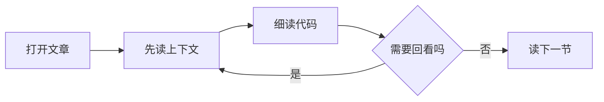

## 先读上下文

代码示例不应该突然出现。先说明它解决的问题，再展示足够小、能独立理解的片段。

## 让关键部分显眼

```ts
interface ReadingNote {
  title: string;
  minutes: number;
}

const note: ReadingNote = { title: "留一点空白", minutes: 5 };
```

读完代码后，用简短的解释指出值得留意的决定。读者可以复制代码，也可以沿着文章目录回到这一节。

## 图示遵循同样的节奏

流程图在构建期渲染成静态 SVG，随页面的深浅主题变色，不需要加载额外的脚本。



图和代码块一样，只在能帮助理解时出现。
