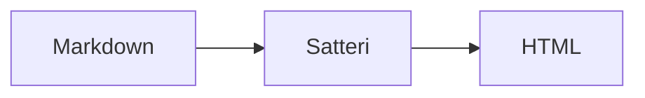

## 欢迎

这是重写后的第一篇示例文章，用于验证内容管线（Content Collections → Satteri → 渲染）。

## 技术栈

- **Astro** 负责静态生成与按需渲染
- **Tailwind CSS 4** + **daisyUI 5** 负责样式
- **Pagefind** 提供全文搜索

参考 [Astro 官方文档](https://docs.astro.build) 了解更多。

```ts
export const hello = (name: string): string => `Hello, ${name}!`;
```

## Mermaid


